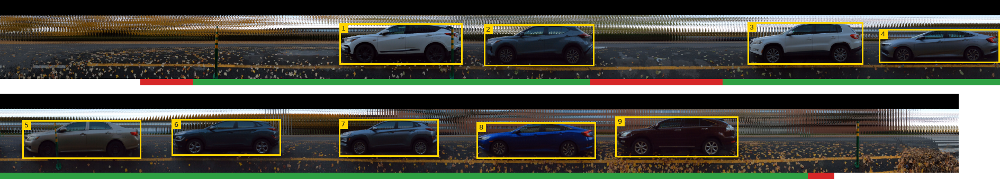
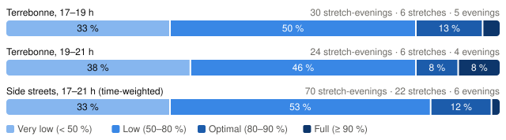

# On-street parking occupancy, rue de Terrebonne and side streets (NDG, Montreal), 2026

How full is the curb on rue de Terrebonne and the avenues around it on weekday evenings? This
repository holds the data, the map and the method notes of a survey made from a bicycle in
October and November 2026. The software that produced it is in a separate repository
([curb-occupancy][code], Apache-2.0); this one needs no software to read.

[code]: https://github.com/laurentpt/curb-occupancy

**Map:** [`index.html`](index.html) (English / français).

## Method in brief

1. **Recording.** A side-facing camera on a bicycle films the curb while riding the street,
   one pass per street per evening.
2. **Curb image.** The video is turned into one continuous side image of the parked row, at
   the depth of the parked cars and to scale along the street. The background behind the cars
   comes out smeared.
3. **Counting.** A vehicle detector finds the vehicles in that image. Each pass is placed on
   the street's centreline, so every vehicle falls in its block (one side of the street
   between two cross streets). Every parked vehicle counts, including those in front of a
   driveway or too close to a corner. A vehicle on a cross street's roadway does not count:
   it is not parked.
4. **Capacity.** The parkable curb length is the curb minus intersection approaches, the
   no-stopping and reserved zones in force at the time of the pass (City of Montreal
   signage open data), hydrant clearances and driveways. On rue de Terrebonne the driveways
   were drawn by hand on the curb images. On the side streets an image classifier trained on
   those labels (not released) proposed candidates, and the author reviewed each one on the
   images, keeping, correcting or rejecting it (one, marked uncertain, was kept as proposed).
   Capacity is that length at 5.5 m per space, counted per parkable piece of curb, in whole
   spaces.
5. **Occupancy** = parked vehicles / capacity. It is reported per stretch of about 25 spaces
   and per street, in two time slots: early evening, 17-19 h (passes started 17:17-18:01, at
   dusk), and late evening, 19-21 h (passes started 19:57-20:46, in the dark). The 17-21 h
   figure weights the two slots equally (two hours each).

The method adapts the occupancy measure of the reference study: Ville de Montréal,
[*Plan de suivi, REV dans l'axe Bellechasse*][ref] (2021; parking occupancy pp. 29-38).
Counting whole spaces per piece of curb gives fewer spaces than dividing the total length by
5.5 m, so the method presented here estimates occupancy higher than the reference study's method would.

[ref]: https://github.com/OpenMobilityData/Terrebonne-access-requests/blob/main/2025-12847/raw/Annexe_1.12_Plan_de_suivi_REV_Bellechasse_2022-02-18.pdf

*One block, one pass. The numbered boxes are the vehicles counted. The bar below shows the curb
status at the time of the pass: green is parkable, red is no stopping.*

## Results

50 passes on 9 weekday evenings, 2026-10-23 to 11-12. Rue de Terrebonne (the side where
parking is allowed) and 11 avenues crossing it (one side each).

| | 17-21 h (both slots, equal weight) | 17-19 h | 19-21 h |
|---|---|---|---|
| Whole area (12 streets) | **58 %** | 65 % | 55 % |
| Rue de Terrebonne | 60 % | 61 % | 60 % |

The whole-area slot figures compare different streets, not the same curb at two times: the
side streets ridden only at dusk (Draper, Hampton, Hingston, Melrose) count in 17-19 h only,
and those ridden only at night (Mayfair, King Edward, Prince of Wales, Madison) in 19-21 h
only. They do not show occupancy falling through the evening. On rue de Terrebonne, ridden in
both slots, the two are 61 % and 60 %.

*How often is the curb full? Each bar splits the street stretches (sections of about 25 spaces)
by how full they were on each evening of the survey. For example, on rue de Terrebonne between
19 h and 21 h, a stretch was low or very low (under 80 %) on 83 % of evenings (20 of 24
stretch-evenings). For the side streets, early and late evening are combined: each stretch
counts once, with its two time slots weighing equally.*

- On their evening mean, none of the 28 stretches reaches the "full" class (90 % and over),
  though a few do on single evenings (figure). 4 are optimal (80-90 %), 18 low (50-80 %) and
  6 very low (under 50 %). The classes are those of the [reference study][ref] (pp. 33-34):
  85 % is generally considered optimal, and its maps show 80-90 % as optimal, over 90 % as
  high and under 80 % as low. The very low class (under 50 %) is added here.
- Occupancy is similar on Terrebonne and its adjacent side streets, and in the two time slots
  on Terrebonne (17-19 h and 19-21 h).
- Over time, occupancy of the stretches is low or very low (under 80 %) in 83-86 % of the evenings.
- The fullest stretches (80-85 %) are Avenue Royal and Avenue Wilson next to Terrebonne,
  Avenue de Melrose north of Terrebonne, and Terrebonne between Benny and Beaconsfield. The
  emptiest (17-44 %) are Avenue King Edward, Avenue de Mayfair, and Terrebonne west of
  Montclair.
- **Capacity of the area** (the avenues crossing Terrebonne from Belmore to Old Orchard,
  Somerled to Monkland, plus Terrebonne): about 2940 spaces (90 % interval 2840-3040). About
  830 of them were measured. The others are estimated from the measured spaces per metre and
  the street lengths.

## Files

| file | content |
|---|---|
| `index.html` | the map: occupancy and capacity views, per stretch, per slot and per evening |
| `data/stretches.csv` | stretches (about 25 spaces each): evening mean parked, capacity, occupancy, class |
| `data/stretches_slots.csv` | the same per time slot |
| `data/stretch_evenings.csv` | one row per stretch and evening |
| `data/blocks_by_pass.csv` | one row per block, side and pass: capacity, parked vehicles, vehicles outside a legal spot |
| `data/capacity_faces.csv` | every block face of the area: measured or estimated spaces |
| `data/layers.geojson` | map layers: curb status, stretches, capacity faces, anonymous parked-vehicle footprints |
| `data/summary.json` | headline figures |
| `inputs/` | the open-data snapshots used, with retrieval date and checksum ([`inputs/README.md`](inputs/README.md)) |
| `config/` | the study configuration: every street, pass and setting, the driveway labels (`*_curb.yaml`) and the sign corrections |
| `docs/stretch_evenings.svg` | the figure above, drawn from `data/summary.json` |
| `docs/validation.md` | checks: hand count, detection, placement, signs against parked cars, limits |

Apart from the example block above (checked: no readable plate or face), no images of the
street are published, and no per-vehicle rows or GPS tracks. The vehicle
footprints on the map carry only their position and the pass.

## Reproduce

The software is [curb-occupancy][code] [v0.1.0][v010]. Install it, then run its
`curb-occupancy` command from the root of this repository: paths in `config/` are relative to
it, and outputs go to `workdir/runs/<name>/`. For example
`curb-occupancy area config/streets/_area_final.yaml` rebuilds the tables in `data/` and the
map from the street runs. The raw video is not published (it shows faces and plates), so the
per-pass stages need recordings of your own. The configuration still records every setting,
every manual label and every correction behind the figures.

[v010]: https://github.com/laurentpt/curb-occupancy/tree/v0.1.0

## Limits

Weekday evenings in autumn only, no snow. The passes cover about one hour of each slot
(started 17:17-18:01 and 19:57-20:46): each slot's figure rests on that hour. The side
streets were recorded on one side each, and 8 of the 12 streets were recorded in only one of
the two time slots. Avenue de Melrose has 2 evenings, the others 3 or more. Details in [`docs/validation.md`](docs/validation.md).

## Use of AI

This work follows the European Commission's [*Living guidelines on the responsible use of
generative AI in research*](https://research-and-innovation.ec.europa.eu/document/2b6cf7e5-36ac-41cb-aab5-0d32050143dc_en)
(ERA Forum, fourth version, October 2026).

- **What AI was used for.** The software (pipeline, tests, map page) and the analysis scripts
  were written with an AI coding agent, working
  under the author's direction. The agent also drafted parts of this documentation.
- **How its output was verified.** The author checked and validated the outputs and the
  results. That covers:
  - a hand count of two passes from the raw video;
  - visual review of the detections on the curb images;
  - review of every driveway label;
  - sign and pole corrections checked on the images and on site.

  The author also made every methodological decision. Example checks are described in
  [`docs/validation.md`](docs/validation.md).
- **Reproducibility.** No generative AI runs inside the pipeline. The vehicle detector is a
  standard object-detection model. The side-street driveway candidates came from a small image
  classifier (not generative, not released); they enter the figures only through the reviewed
  labels in `config/`. The figures can be reproduced from the published code,
  configuration and inputs, without any AI assistant.
- **Responsibility.** The author is responsible for the results.

## Licences

- Data: [CC BY 4.0](https://creativecommons.org/licenses/by/4.0/), except
  `data/layers.geojson` and the map `index.html` (which embeds the same layers), whose curb
  geometry is derived from OpenStreetMap:
  [ODbL 1.0](https://opendatacommons.org/licenses/odbl/1-0/).
- Includes OpenStreetMap data © OpenStreetMap contributors (ODbL 1.0) and City of Montreal
  open data (parking signage, fire hydrants; CC BY 4.0).
